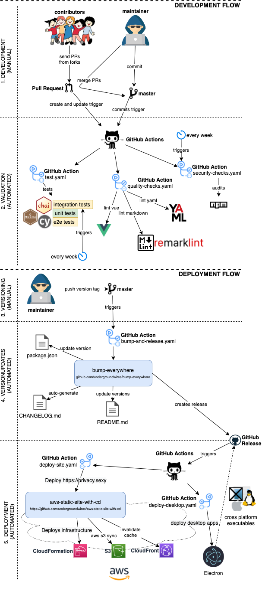

# CI/CD overview

## GitOps

CI/CD is fully automated using different Git events and GitHub actions. This repository uses [bump-everywhere](https://github.com/undergroundwires/bump-everywhere) to automate versioning, tagging, creation of `CHANGELOG.md` and GitHub releases. A dedicated workflow [release.desktop.yaml](./../.github/workflows/release.desktop.yaml) creates desktop installers and executables and attaches them into GitHub releases.

Everything that's merged in the master goes directly to production.

[](../.github/workflows/)

## Pipeline files

privacy.sexy uses [GitHub actions](https://github.com/features/actions) to define and run pipelines as code.

GitHub workflows i.e. pipelines exist in [`/.github/workflows/`](./../.github/workflows/) folder without any subfolders due to GitHub actions requirements [1] .

Local GitHub actions are defined in [`/.github/actions/`](./../.github/actions/) and used to reuse same workflow steps.

## Local CI

The [sm18lr88/privacy.sexy](https://github.com/sm18lr88/privacy.sexy) fork disables GitHub Actions to save CI minutes.
The workflow files stay as the reference definition, and [`scripts/local-ci`](./../scripts/local-ci/) runs their Linux legs in Docker:

```sh
npm run ci:local                      # Default jobs against the committed HEAD
npm run ci:local -- --worktree        # Include uncommitted and untracked changes
npm run ci:local -- --only unit,lint-eslint
npm run ci:local -- --all             # Add desktop runtime, external URL, CodeQL, and install-deps jobs
npm run ci:local -- --list            # List jobs and their source workflows
```

- Requires Docker Desktop (or another Docker engine) running Linux containers.
- Each run tests a `git archive` snapshot in a disposable container, so integration tests and desktop checks never touch the host.
- Named volumes `privacy-sexy-local-ci-npm` and `privacy-sexy-local-ci-cache` cache npm, Electron, Cypress, uv, and CodeQL downloads.
- Logs, `summary.json`, and artifacts (coverage, e2e videos, screenshots, SARIF) are written to `dist-ci/<run-id>/`.
- The command exits with a nonzero code if any job fails.
- Not covered: macOS and Windows matrix legs, `configure-vscode`, and the `release.*` workflows.

## Pipeline types

We categorize pipelines into different categories. We use these names in convention when naming files and actions, see [naming conventions](#naming-conventions).

The categories consist of:

- `tests`: Different types of tests to verify functionality.
- `checks`: Other controls such as vulnerability scans or styling checks.
- `release`: Pipelines used for release of deployment such as building and testing.

## Naming conventions

Convention for naming pipeline files: **`<type>.<name>.yaml`**.

**`type`**:

- Sub-folders do not work for GitHub workflows [1] so we use `<type>.` prefix to organize them.
- See also [pipeline types](#pipeline-types) for list of all usable types.

**`name`**:

- We name workflows using kebab-case.
- E.g. file name `tests.unit.yaml`, pipeline file should set the naem as: `name: unit-tests`.
- Kebab-case allows to have better URL references to them.
  - [README.md](./../README.md) uses URL references to show status badges for actions.

[1]: https://web.archive.org/web/20250126141528/https://docs.github.com/en/actions/writing-workflows/workflow-syntax-for-github-actions#about-yaml-syntax-for-workflows "Workflow syntax for GitHub Actions - GitHub Docs | docs.github.com"
